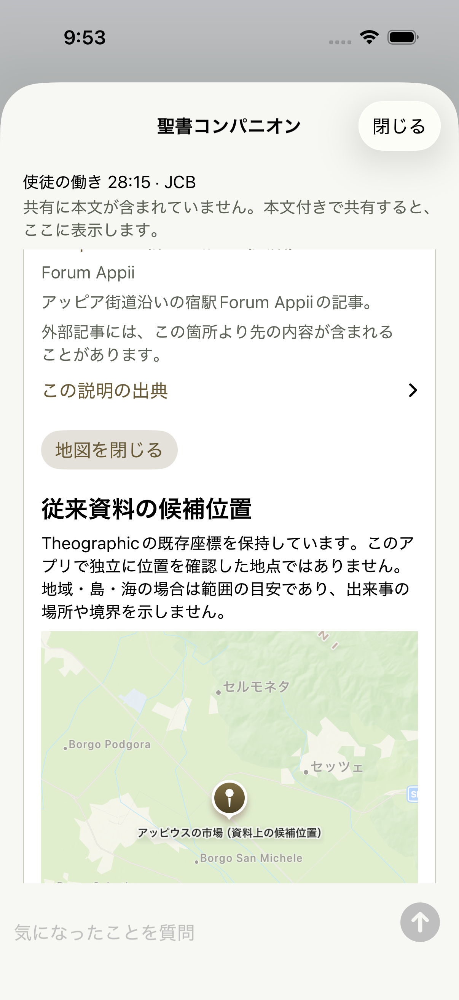

# Acts 28:15 place-tab investigation

Baseline: public main `1944c6f` (0.1.17), built in an independent checkout. The debug host alone was extended to share the reported complete text and `https://bible.com/bible/83/act.28.15.JCB`; production lookup/map code was unchanged. The original supplied Japanese text is not bundled into the regression fixtures in this PR.

The actual Share Extension opened the passage and place tab. After eight seconds of map observation, the extension remained open and the baseline native test passed. The reported physical-device crash was **not reproduced on Simulator**. No matching crash report or abnormal termination reason was obtained. Simulator resident memory was observed around 380–395 MiB during this baseline; this is RSS, not an iPhone jetsam limit or a proven diagnosis. A physical-device IPS/JetsamEvent report remains necessary to establish the user's termination cause.

The passage resolves to three unique place IDs (Appii Forum, Three Taverns, Rome), all with finite, in-range candidate coordinates. The old inline view eagerly constructed an interactive MapKit map for every place card, including offscreen cards. This is an avoidable extension-memory risk, not proof that MapKit caused the reported crash.

The change keeps descriptions immediately available and mounts one map only when its place's map button is selected. Selecting another place replaces the active map. Pan, zoom, scale, candidate-location notes and source disclosures remain available inside the share screen. A memory warning closes the active map and leaves the descriptions available. Map-opening buttons have a 44-point minimum target, and decorative card borders do not intercept touches.

Regression routes cover the actual extension, Acts28:15 twice, another multi-place passage (Acts27:2), map open/close, chat/places tab changes and software-keyboard send visibility. The general share tests also cover zero startup AI dispatches, queued follow-ups, preserved drafts after a response and reopening, unavailable setup, uncertain stream termination and the maximum accessibility text size. UI answer text is synthetic; these tests never call Gemma or another inference service.

The repeated-extension keyboard check includes a SpringBoard AX fallback. On a reopened share, XCUITest sometimes omits the keyboard from both app queries even though the attached screenshot visibly contains it. In that case the test checks the focused keyboard-dismiss control, editable text and hittable send button, with manual screenshot verification. This is reported as a Simulator accessibility limitation, not an application crash or a successful strict AX keyboard measurement.

Verified native runs (dedicated iPhone17Pro/iOS26 Simulator):

- Baseline `Test-ReadingInteractionUI-2026.10.17_09-27-26-+0900.xcresult`: reported full-text input, place tab remained open, 1 test passed.
- Fixed `Test-ReadingInteractionUI-2026.10.17_09-52-49-+0900.xcresult`: Acts28:15 twice plus Acts27:2, map open/close, tab changes and keyboard round trips, 1 test/3 scenarios passed in 104.8 seconds.
- A private local full-text variant also opened the fixed map and captured the visible keyboard on both same-verse openings. That earlier run failed its strict AX keyboard query; the attached images confirmed the query omission described above. The quoted Japanese text was restored out of the tracked debug host afterward.

